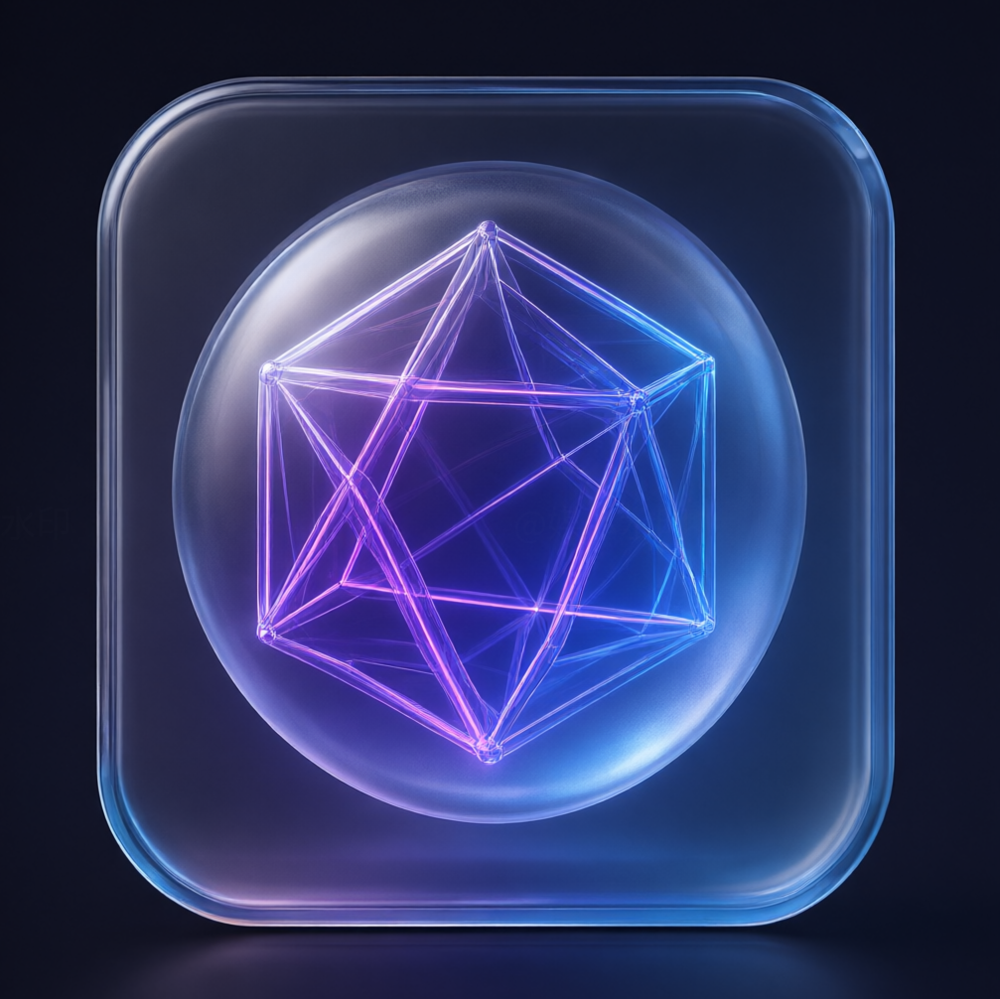

# Omni Viewer



Учебный просмотрщик OBJ для командного задания по компьютерной графике. Текущее состояние — стартовая версия: отображается каркас одной модели, а не готовый программный рендер.

## Архитектура и командная работа

Целевая структура пакетов под `src/main/java/com/cgvsu/`:

```text
app/                         # запуск приложения
ui/                          # JavaFX-интерфейс
scene/                       # сцена и объекты
model/                       # геометрия и полигоны
io/obj/                      # импорт и экспорт OBJ
math/                        # векторы и матрицы
camera/                      # камера
rendering/mesh/              # триангуляция и нормали
rendering/rasterization/     # заполнение и Z-буфер
rendering/shading/           # текстуры и освещение
```

Создавайте пакеты вместе с первыми классами — Git не хранит пустые папки. Текущие классы пока находятся в старых пакетах; переносите их постепенно.

Работа ведётся в трёх ветках от `main`: `feature/ui`, `feature/math`, `feature/rasterization`.

### Участник 1 — `feature/ui`

Папки: `app/`, `ui/`, `scene/`, `model/`, `io/obj/`; FXML — `src/main/resources/com/cgvsu/fxml/`.

- Улучшить и протестировать OBJ-загрузчик; реализовать сохранение через `ObjWriter`.
- Поддержать несколько моделей, выбор активной модели, удаление вершин и полигонов.
- Сделать удобный интерфейс, отображать ошибки пользователю и подготовить портативную сборку.

### Участник 2 — `feature/math`

Папки: `math/`, `camera/`; тесты — в соответствующих пакетах `src/test/java/com/cgvsu/`.

- Заменить `javax.vecmath` собственным модулем: векторы 2D/3D/4D, матрицы 3×3/4×4 и операции над ними.
- Переделать весь графический конвейер на векторы-столбцы; реализовать матричные перенос, поворот и масштабирование.
- Добавить трансформации модели из UI и улучшить управление камерой. Покрыть код тестами.

### Участник 3 — `feature/rasterization`

Папки: `rendering/mesh/`, `rendering/rasterization/`, `rendering/shading/`; тесты — в соответствующих пакетах `src/test/java/com/cgvsu/`.

- После загрузки триангулировать модель и пересчитывать нормали.
- Реализовать заливку полигонов с Z-буфером, текстуры и освещение.
- Добавить переключение каркасного режима, текстуры и освещения; поддержку нескольких камер.

Изменения общего формата `model/` (`Model`/`Polygon`) согласовывать с командой. До параллельной работы согласовать типы векторов (вектор-столбец должен быть) и API камеры/рендерера (делай как знаешь, потом на мёрже разберёмся).

## CI/CD и релизы

GitHub Actions запускает Java-тесты на Linux и собирает portable-версии для Linux и Windows. Чтобы выпустить релиз, отправьте тег `vX.Y.Z` на нужный коммит `main` — CI/CD выполнит проверки, сборку и публикацию в GitHub Releases.

## Известные ограничения

- OBJ Reader остаётся учебной реализацией: проверены основные формы граней и индексы, но полная совместимость с OBJ, материалами и всеми вариантами файлов ещё не гарантируется. Неподдерживаемые директивы игнорируются.
- Используется временная библиотека `vecmath`; весь графический конвейер предстоит перевести на собственную математику и векторы-столбцы.
- Отсутствуют полноценное отсечение у плоскостей камеры, Z-буфер, заливка, текстуры, освещение, несколько объектов и камер. Отрисовка идёт в UI-потоке с таймером; тяжёлые модели могут тормозить.
- Версии JavaFX и JUnit зафиксированы в `pom.xml`; JavaFX 25 LTS выбрана для стабильности с JDK 26. Проверяйте обновления и совместимость перед переходом на новую ветку.
